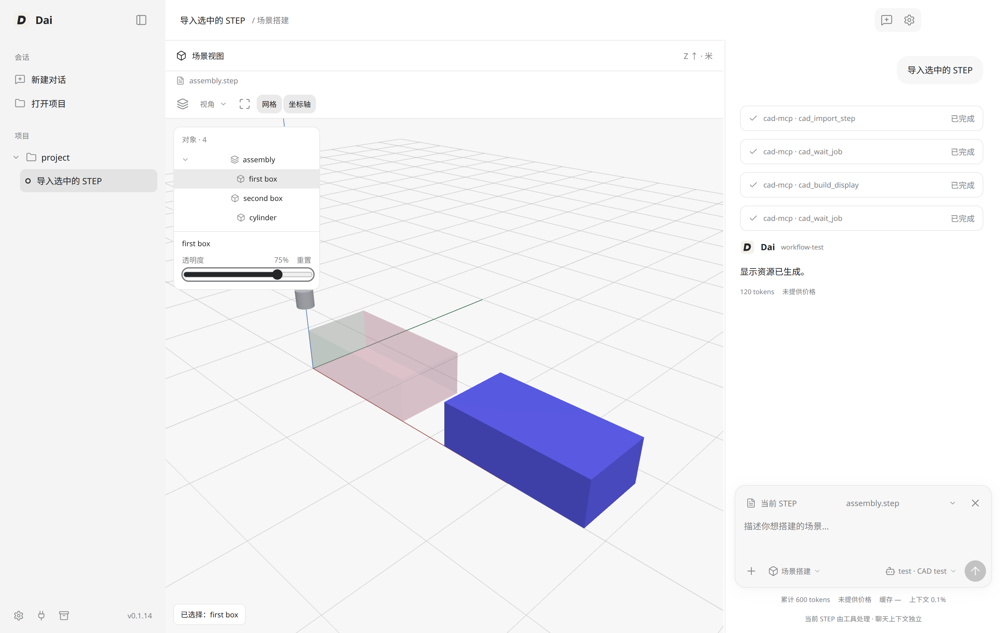
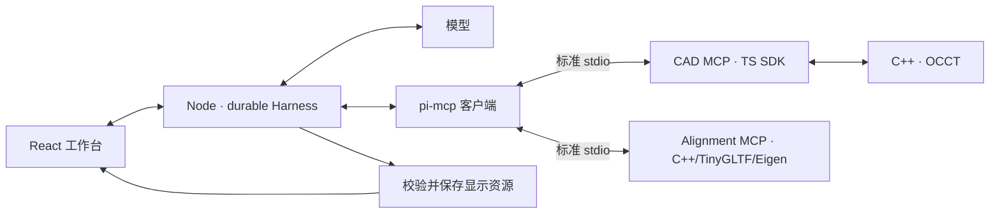

<p align="center">
  
</p>

<h1 align="center">Dai</h1>

<p align="center">今天想和呆呆完成什么？</p>
<p align="center">围绕本地项目，把 AI 对话、CAD 工具和三维查看放在同一个工作台。</p>

<p align="center">
  <a href="#快速开始">快速开始</a> ·
  <a href="#工作方式">工作方式</a> ·
  <a href="#构建与检查">构建与检查</a> ·
  <a href="spec/README.md">开发规范</a>
</p>



<p align="center"><sub>使用测试装配展示真实 CAD 导入、对象树、实体选择与透明度查看。</sub></p>

## 当前能力

| 能力 | 说明 |
| --- | --- |
| 本地项目 | 直接打开文件夹，管理多条对话、草稿与历史；STEP 保留在原目录 |
| 多模型对话 | 复用 pi-ai 的模型目录、认证和受支持推理档位，按会话保存选择 |
| 聊天展示 | Markdown 表格、列表与代码块；可展开的执行过程、工具参数/结果和公开思考文字 |
| 整机定位 | 独立 alignment-mcp 支持包围盒、角点归零、参考系对齐与绕轴旋转，保存绝对位姿，不改原 STEP |
| CAD 导入 | 模型根据提示词与 Skill 调用内置 CAD MCP，解析 STEP 并生成显示资源 |
| 三维查看 | 原始层级、颜色、单位与实例位置；对象树联动、表面高亮、透明度与视角切换 |
| 工具与技能 | 按项目和模式配置外部 stdio / Streamable HTTP MCP 与 Markdown Skill |
| 桌面体验 | 深浅主题、一体化顶栏、快捷键、托盘隐藏与单实例恢复 |

目前聚焦 **STEP 导入、只读几何查看与整机定位**。关节装配、运动学、URDF 导出和对象级场景编辑尚未接入。

## 快速开始

### 启动开发版

需要 **Node.js ≥22.19.0、npm ≥10**，建议使用 `.node-version` 指定的版本。桌面启动与集成测试需要图形环境。

```bash
npm ci
npm run dev
```

前端修改自动热更新。安装版与开发版默认共用数据目录和单实例锁；开发前通过托盘选择「退出 Dai」关闭安装版，避免再次启动时恢复旧窗口。

没有原生 CAD 模块也可以使用普通对话。需要解析 STEP 时，按下面的步骤构建 CAD worker。

### 启用 CAD

先安装以下原生开发依赖；项目使用标准 `find_package` 查找，不在 CMake 构建时下载或修改第三方源码。

| 依赖 | 要求 |
| --- | --- |
| 编译工具 | CMake ≥3.21、支持 C++20 的编译器 |
| Open CASCADE | **7.9.2**，包含 XCAF / STEP |
| nlohmann_json | ≥3.11 |
| OpenSSL | ≥3.0 |
| Eigen | ≥3.4，供对齐插件进行矩阵计算 |
| TinyGLTF | 带 CMake 包配置的编译库，本机验证版本为 2.9.6 |

```bash
npm run build:native
npm run dev
```

`build:cad` 与 `build:native` 等价。默认读取 `out/native/dai-cad-worker`；Windows 多配置构建读取 `out/native/Release/dai-cad-worker.exe`。可通过绝对路径环境变量 `DAI_NATIVE_DIRECTORY` 指定原生程序目录，无需打开 FreeCAD。

<details>
<summary>依赖前缀与直接使用 CMake</summary>

依赖不在标准位置时，通过 `CMAKE_PREFIX_PATH` 指定安装前缀：

```bash
# Linux / macOS
CMAKE_PREFIX_PATH=/absolute/deps/prefix npm run build:native
```

```powershell
# Windows PowerShell
$env:CMAKE_PREFIX_PATH = 'C:\deps'
npm run build:native
```

也可以直接构建和运行 C++ 测试：

```bash
cmake -S resources/mcp -B out/native -DCMAKE_BUILD_TYPE=Release
cmake --build out/native --config Release --parallel 4
ctest --test-dir out/native --build-config Release --output-on-failure
```

</details>

### 开始使用

1. **打开项目**，选择本地文件夹。在「设置 → AI 设置」配置服务并选择模型。
2. **进入场景搭建**，在聊天栏「当前 STEP」中选择项目内的文件。
3. 发送 **“解析选中的 STEP”**，等待工具完成，即可在中间视口查看模型。
4. 需要归零时发送 **“将整套装配包围盒最小角点对齐原点”**；也可在同一条请求中要求解析、旋转与归零。桌面保存位置，切聊天或重启后继续使用。
5. 在模型旁选择当前模型支持的推理档位；已有会话默认关闭。“常规 → 显示思考摘要”只控制公开思考文字的显示，与请求推理档位独立。

DeepSeek 使用 API Key；OpenAI 订阅使用 OpenAI Codex 账号授权，是否可用取决于账号权限。其他提供方沿用已安装 pi-ai 的认证方式，也可配置本地或 OpenAI 兼容服务。

普通对话默认不启用 CAD、文件或编码工具；切到场景搭建即显示画布。前视从 +X 朝 −X，右视从 −Y 朝 +Y，顶视从 +Z 朝 −Z，统一以米显示。

## 工作方式



**模型决定调用，Harness 执行，真实工具结果驱动显示。** Harness 提供当前模式的提示词、Skill 与工具列表。桌面不预先串联导入步骤，也不从助手回复文字推断“模型已加载”。CAD 插件通过标准 stdio 接入，TS 负责 MCP 协议，C++ 负责几何计算；桌面管理项目授权、资源保存与前端通知。

一个应用数据目录使用 **一个 SQLite、一个 durable Harness**，对话保持独立上下文；当前桌面一次运行一条对话。同项目、同 STEP 的对话共用最近成功导入的模型，切换聊天保留画面、相机、选择和透明度。新导入产物清除旧查看覆盖值；跨来源或重启后重新加载保存结果。

部分面无法生成可靠网格时，只显示通过校验的部分，并提示未显示面数；原始 CAD 与诊断保留，`complete=false` 不伪装成完整。全部无可显示网格或资源加载失败时保留旧画面。高亮与透明度仅影响查看。整机定位单独保存旋转和平移，保持零件相对位置。包围盒来自实际显示三角形；参考系对齐可使用导入时缓存的 CAD 平面、圆心和轴线。模型通过 Pi read 直接读取已登记产物，无需逐次确认；CAD 每个 Run 结束后释放，后续定位不依赖它常驻。这些能力不等同于零件配合或关节定义。

### 数据在哪里

| 位置 | 内容 |
| --- | --- |
| `~/.daidai/`；Windows 为 `%USERPROFILE%\.daidai` | 应用数据根，与启动目录无关 |
| `app.sqlite` | 原生 durable 聊天、任务、设置、项目与显示索引 |
| `credentials.enc` | Electron safeStorage 加密的凭据；系统安全存储不可用时仅本次保留 |
| 项目 `.daidai/artifacts/<importId>/` | 已保存的只读显示清单、GLB 与对象映射 |
| 项目 `.daidai/placements/<importId>.json` | 整机旋转、平移与生产条目版本；插件读取，桌面在 Harness 成功后保存 |

移除项目只隐藏导航，重新打开同一目录可恢复。删除对话会禁止后续访问，底层历史暂留；两者都保留本地文件和共享显示资源。重启恢复记录与已保存模型，不续跑中断的请求。

### 代码导航

```text
src/
  desktop/       Electron 窗口、托盘、系统能力与 Preload
  renderer/      React 工作台与 Three.js 查看器
  backend/       runtime 组合入口；settings / projects / agent / mcp / artifacts
  shared/        跨进程契约、Schema 与推导类型
resources/
  mcp/cad/       CAD 标准 MCP 服务端、C++ include/cad 与 src
  mcp/alignment/ 整机包围盒、参考系对齐与旋转插件；独立 stdio 及 C++ 程序
  skills/        内置 scene-building / scene-alignment Skill
  icons/         暖白底 D 图标与托盘模板
spec/            前端、后端与 CAD MCP 设计
tests/           单元、协议、C++ 与 Electron 集成测试
```

详细设计见 [前端交互](spec/frontend_spec/frontend.md)、[桌面后端](spec/backend_spec/backend.md)、[CAD MCP](spec/mcp_spec/cad-mcp.md)与 [Alignment MCP](spec/mcp_spec/alignment-mcp.md)。Runtime 负责启动、请求队列与退出，各领域模块处理自己的请求；优先复用 Pi、Electron、Three.js 与 OCCT 的现有能力。

<details>
<summary>外部工具与独立 CAD 服务</summary>

「设置 → 工具与技能」可配置全局或项目范围、适用模式及启用状态。Skill 提供工作说明，不授予工具权限；MCP「连接并查看工具」执行真实发现，结束后关闭连接。模型可在运行中发现外部工具，再通过 durable 加入后续请求。服务同名工具使用命名空间隔离。

外部 stdio 的工作目录固定为授权项目；HTTP 不发送本地项目根。当前未提供自定义环境变量、HTTP Header 或 MCP OAuth 的设置界面，也未启用 MCP Task 协议工具。三维回显须遵守显示产物契约，不能仅返回任意文件路径。

CAD 全部 12 个工具共用 [contract.ts](resources/mcp/cad/contract.ts)。独立客户端在 `npm run build` 后，可用 `node dist/main/cad-mcp.js /absolute/config.json` 启动相同服务。可信宿主提供配置：`executable`、`projectRoot`、`stagingRoot` 与可选 `limits`；详情见 CAD spec。stdout 仅承载 MCP 协议，原生进程按需启动。

停止与退出会等待本轮连接及原生进程清理；取消不等于撤销远端业务副作用，未知的调用结果不会自动重放。

</details>

## 构建与检查

| 命令 | 用途 |
| --- | --- |
| `npm run build` | 类型检查并构建桌面到 `dist/` |
| `npm start` | 运行已构建的桌面 |
| `npm run lint` / `npm run format` | Biome 检查 / 格式化 |
| `npm test` | 构建并串行运行单元、MCP 与 Electron 集成测试 |
| `npm run check` | 静态检查、构建与测试 |
| `npm run test:cad` | 构建桌面与原生模块，运行 CTest 和 CAD 回归 |

真实 CAD 用例按环境启用：`DAI_CAD_TEST_WORKER` 指向 worker，`DAI_CAD_TEST_FIXTURE` 指向 `cad-core-tests`，`DAI_CAD_REAL_STEP` 指向本机 STEP 样本，`DAI_ALIGNMENT_TEST_WORKER` 指向 `dai-alignment-worker`。未提供相应路径时，条件用例会跳过。自动模型测试使用本地脚本协议服务，不消耗个人密钥或付费模型。

TypeScript / TSX、CSS 与 JSON 使用 Biome；C++ 使用根目录 `.clang-format`，遵循 daidai 的命名与格式：类型 PascalCase、函数 camelCase、文件及字段 snake_case、私有成员 `_` 后缀。逻辑段落间留一个空行，相关短语句保持在一起。测试统一放在 `tests/`，运行数据、凭据、依赖目录和构建产物不提交。

## 安装包与桌面行为

| 目标系统 | 构建命令 | 产物 | 验证状态 |
| --- | --- | --- | --- |
| Linux | `npm run package:deb` | `.deb` | Ubuntu 24.04 x64 已验证 |
| macOS | `npm run package:mac` | `.dmg` | 已配置，待目标系统构建验收 |
| Windows | `npm run package:win` | NSIS `.exe` | 已配置，待目标系统构建验收 |

安装包在对应系统构建，自动包含图标、应用菜单入口与 CAD 原生运行依赖；打包也需要上述原生开发依赖。`npm run package:dir` 生成不带安装器的应用目录。文件名以实际版本和架构为准，例如：

```bash
sudo apt install ./release/daidai-pi_0.1.14_amd64.deb
```

安装后从应用菜单打开 **Dai**，Linux 也可运行 `daidai-pi`。安装版无需额外安装 Node.js。关闭窗口隐藏到托盘，选择「退出 Dai」才结束进程；再次启动恢复原窗口。常用快捷键：`Ctrl/Cmd+N` 新建对话、`Ctrl/Cmd+O` 打开项目、`Ctrl/Cmd+,` 设置、`Ctrl/Cmd+B` 项目栏，`Ctrl/Cmd+加减号` 缩放、`Ctrl/Cmd+0` 还原。

目前采用本地安装包更新，未配置自动更新或 APT 软件源；`apt update` 不会获取项目新版。macOS 未完成公证，Windows 未配置受信任签名，正式分发仍需在目标平台验收。当前实机验证以 Linux 为主。

## 许可

本项目当前标记为 **UNLICENSED**。第三方组件声明统一维护在根目录 [LICENSE](LICENSE)，不代表本项目原始代码采用这些第三方许可证。
