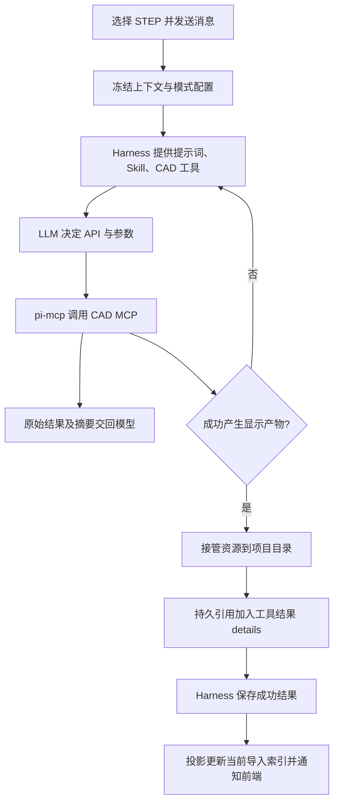

# 桌面后端设计

更新：2026-10-26。状态：通用 stdio 插件加载、原始 MCP 结果转发、显示产物接管及持久索引已接入；Runtime 已收拢为启动、请求队列和退出的组合入口，领域请求分布于现有模块。范围和工程约束见 [规范入口](../README.md)，交互见 [前端设计](../frontend_spec/frontend.md)，插件契约见 [CAD MCP 设计](../mcp_spec/cad-mcp.md)。

## 1. 职责与进程

Electron Main 管窗口、系统能力和受控资源协议；Preload 暴露有限类型化 API；独立 Node 后端管理应用数据、AI、Harness、MCP 连接及显示产物。builtin 通过 pi-mcp 标准 stdio 接入 CAD、Alignment 和 Viewport 插件；TS SDK 服务端负责协议，CAD 与 Alignment 的 C++ 程序负责几何计算，Viewport 通过宿主接口获取渲染器画面。发现阶段不启动原生计算，执行时按需启动。

一个应用数据目录只打开一个 SQLite 和一个 durable Harness，各对话保持原生身份与独立上下文。首阶段保持一个前台 Run，工具按顺序执行；不新增执行器、工作流状态机、任务队列或第二份聊天记录。

业务顺序由 LLM 根据 Skill 和真实工具结果决定。后端不自动串联导入/等待/显示，不注册 scene_import_selected_step 一类替代 CAD API 的业务工具。

## 2. 模块与依赖

当前目录如下；按实际职责组织文件，不预建空模块或继承层。

```text
src/backend/
  index.ts                 # IPC 入口，创建并关闭应用
  runtime.ts               # 组合存储、领域请求、统一队列及应用退出
  types.ts                 # 方法与输入/输出相关联的 Handlers 类型
  projects/handlers.ts      # 项目、STEP 关联、对话元数据及显示查询
  projects/placements.ts    # 整机定位的成功结果投影、项目文件与恢复
  settings/handlers.ts      # 配置快照、Provider、登录与 Skill 请求
  settings/documents.ts     # SettingsRecord 与 durable 配置文档
  agent/session.ts         # 单一活动 Run、订阅、发送、停止及收尾
  agent/types.ts           # ActiveRun、冻结的 RunContext 和 SceneContext
  agent/scene.ts           # 当前显示身份、定位及可读路径的一致投影
  agent/projection.ts      # durable 事件、快照恢复与统一展示状态
  agent/projectionMessages.ts # 已提交条目及原生用量的无状态展示转换
  agent/presentation.ts    # 展示参数遮蔽、有界预览和公开内容块
  agent/                   # 模式提示词、Skill、工具注册及事件投影
  mcp/handlers.ts           # MCP 配置与可取消的工具发现请求
  mcp/secrets.ts            # 传输字段校验与系统凭据恢复
  mcp/                     # builtin、连接、发现、调用、取消和资源读取
  artifacts/               # 显示产物接管、持久索引和资源查询
src/shared/
  application.ts           # 前后端请求/结果/事件的 Schema 与推导类型
  display.ts               # ImportedModelRef、ImportedModel 等显示契约
resources/mcp/cad/          # CAD 自己的协议与原生实现
resources/skills/scene-building/SKILL.md
```

| 模块 | 所有权与边界 |
| --- | --- |
| runtime | 打开唯一 Harness、先清理旧任务、组合领域处理器、维持请求顺序并关闭资源；不写认证、几何或产物算法 |
| projects | 真实目录身份、STEP 扫描/关联、对话元数据；聊天执行/历史交给 durable |
| settings | 复用 pi-ai Provider/AuthInteraction/CredentialStore；复用现有认证算法和安全存储 |
| agent | 唯一 Harness、模式提示词、本轮冻结上下文、工具注册及 watchEvents 投影 |
| mcp | pi-mcp 统一 stdio/http 连接、实际 tools/list、通用 durable ToolTask 适配；不解释 CAD 命令，不运行插件服务端 |
| artifacts | 接收显示契约、校验/接管文件、记录成功导入及提供前端资源 |
| CAD 插件 | 不导入 src/backend，不接收 SceneHost、数据库或 Harness 回调 |

产物校验的稳定入口仍为 `artifacts/validation.ts`，按格式转出 `validation/manifest.ts`、`validation/geometry.ts`、`validation/features.ts`。GLB 对象、面映射、排除面与三角形覆盖检查留在同一几何校验模块；有界 JSON 文件读取集中在 `artifacts/files.ts`。`prepare.ts` 保持原有校验与接管顺序，不新增管理器或校验框架。

聊天投影由 `createProjection` 独占 calls/seen/live/outputWindows 与 ConversationView；快照和增量事件共用同一状态。`projectionMessages.ts` 仅根据条目、只读调用索引和模型目录转换消息/用量，不拥有历史或事件状态。`presentation.ts` 集中参数脱敏、公开内容预览与工具展示元数据。外部接口、事件处理顺序和一次返回一次拷贝保持不变。

普通流式事件按最多 50ms 合并后生成并发布完整视图；终态和失败立即发布。切换观察时丢弃旧待发批次，通过新的 watch 快照恢复。当前 IPC 仍传完整视图。产物与定位恢复共用条目分页扫描，仍各自维护队列；定位重建保持按条目 ID 的全局因果顺序。

运行目标类型集中于 agent/types.ts，持久结构与所属模块的 durable 文档一起定义；跨模块类型只在其所属模块导出，跨进程契约集中于 shared。领域处理器使用普通函数和明确依赖，不新增通用容器、路由框架或继承层。保留成熟的小函数，不重新实现 SDK 提供的能力。

## 3. 核心数据结构

| 类型 | 字段与语义 |
| --- | --- |
| StepSource | id、projectId、relativePath；同目录同路径复用身份，同内容不同路径不自动合并 |
| RunContext | conversationId、project、sourceId、selectedSourcePath、source、skill；sourceId 独立于实际文件存在性；source 是可读文件快照，含来源 id、绝对 path、相对路径及发送时 sha256；模式/模型及 MCP/Skill 配置快照沿用原生配置和 app.input，不在显示模块重复保存 |
| ActiveRun | conversationId、scene、context、skillBody、mcp；会话模块唯一持有的本轮运行记录，完成回调用对象身份核对归属，防止旧任务收尾释放新任务资源 |
| ImportedModelRef | importId、sourceId、sourceHash；持久模型引用，不含任意本地路径 |
| ImportedModel | 引用、projectId、importFingerprint、producerTaskId、producerEntryId、清单及资源的受控 URL/大小/hash、创建时间和警告；查询时附 sourceStatus:current/changed/missing |
| DisplayDetails | 通用工具身份、display?:ImportedModelRef、displayError?:{code,message}；写入 Harness 工具结果 details |
| Placement | importId、sourceHash、revision、translation、rotation；整个显示装配的绝对根位姿，revision 沿用成功生产条目 ID，不复制网格 |
| ViewState | 前端临时相机、选择及加载状态；后端不保存为业务版本 |
| MessageInfo / MessageBlock | 原生条目投影：正文、公开 text/thinking 块、模型用量与时间；工具结果关联 callId/callKey、参数预览及截断标记 |
| ToolProgressInfo / ConversationView | 活动工具、当前公开回复块与实际阶段；快照从 durable 恢复，调用键由 assistant 条目及 callId 组成，不新增过程数据库 |

展示预览只用于前端：工具文本上限 8,000 字符，公开思考块上限 64,000 字符；参数限制深度、条目及字符串长度并遮蔽常见凭据字段。原始参数执行、原生历史及模型请求不受展示裁剪影响。redacted 内容与 thinkingSignature 不进入展示契约。`showThinking` 存入现有设置文档，仅改变显示；交互规则见 [前端设计第 9 节](../frontend_spec/frontend.md#9-对话过程展示)。

CAD 自己的 document/job/object 及 DisplayArtifact 按 [插件契约](../mcp_spec/cad-mcp.md) 定义，后端不创建另一套 CAD 对象 ID 或查询 API。

importId 标识一次完整显示产物，与聊天身份、临时 CAD 句柄分开。源文件 hash 表示内容版本，importFingerprint 表示导入方式，具体网格资源由 importId 和清单确定。不设计对象级可编辑 SceneDocument、previousId 历史链或独立场景执行器。整机定位仅增加 Placement：保存绝对平移、四元数和成功生产条目 ID；读取与授权见第 11 节，不增加第二套场景历史。

ImportedModel 指向插件生成的只读清单与资源；桌面不再维护一份含颜色覆盖、分组、连杆和关节的第二模型。运行任务、订阅和配置更新保持单一所有者，数据传给调用方时返回只读快照或副本。

## 4. 完整工作流



选中 STEP 的完整绝对路径在本轮上下文中提供给模型，cad_import_step 的 path 必须由模型显式返回。执行前验证它属于本轮所选项目和文件，不能缺省代选。插件自己负责解析、几何版本和句柄，不从全局当前 UI 状态取目标。

CAD 文档导入、显示资源生成及 job 等待是独立工具；模型可以选择先查询结构。返回 job 仅表示任务已接受，只有成功的显示结果触发资源接管。重复查询同一完成 job 必须复用同一显示产物，不生成重复导入记录。

## 5. 显示产物接管与 Harness

MCP 服务可在 CallToolResult 的 `_meta["dai/display"]` 提供 DisplayArtifact。它是应用约定，不是 MCP 自动识别的三维标准。通用工具适配只校验这一契约，不按 toolName、助手文字或原始 JSON 字符串猜测显示行为。

处理顺序：

1. MCP 返回结果，通用适配检查错误/取消、显示契约、来源 hash 和本轮目标。
2. artifacts 从服务返回的已登记资源引用获取清单与文件。同机受信任 stdio 使用 file URI 流式复制，校验其属于该连接的私有输出范围，并校验大小/hash、对象映射及依赖；接管到用户数据根中该项目的产物目录。服务间不传内存读取回调。
3. 完整文件准备好后返回 ImportedModelRef，适配将其放入 ToolExecutionResult.details，模型仍得到真实工具输出及必要警告。
4. Harness 成功结果被记录后，结果投影记录 ImportedModel 和该来源最近成功的 importId，发布 display.changed。只有文件存在、校验通过且有成功工具结果的产物才能进入当前显示索引。

资源接管在工具返回给 Harness 前 await 完成，防止后续 release/退出先清空插件临时文件。来源属于冻结 RunContext，不能因用户界面切换被挂到另一个 STEP。接管显示或定位失败时，工具结果标为失败，保留原始计算输出并在 details 和模型可见文本中说明桌面接管失败；不发布该工具结果的显示或定位引用，保留原状态，不将已完成的计算描述为未执行，也不引导盲目重试。

重复工具结果、重复订阅及重连按服务实例＋产物资源身份复用 importId；ImportedModel 保存 producerTaskId/producerEntryId 供核对，不新增通用去重账本。事件通知失败不撤销成功结果。成功结果已记录而索引尚未更新时，重连/启动以原生成功记录核对并幂等补齐；不执行工具、不依据旧聊天文字覆盖新结果。该故障窗口必须有实际恢复测试。

结果订阅不能因用户当前只看普通聊天而丢失索引更新。前端只在显示来源匹配时加载；首次订阅读取该来源最新索引，不能依次播放历史中的每个模型引用。

当前实现：artifacts/prepare.ts 流式复制服务已登记且位于该连接私有目录内的资源，校验来源、大小/hash、对象树、独立 GLB 和完整 CAD 面映射；单份清单上限 32 MiB，整份显示资源上限 2 GiB。持久清单复用 CAD 格式，仅将资源 URI 替换为 dai-resource URL，保留原始层级和几何，不另建一份可编辑场景。metadata.json 记录接管信息；准备完成通过同目录原子 rename 发布文件。

artifacts/store.ts 通过 Harness 的公开 subscribeCommits 观察已提交条目，异步索引成功 toolResult.details.display；不依赖当前聊天的 UI 订阅。ImportedModel 和每来源的最近导入索引使用原生 Documents，来源指针按生产条目 ID 单调更新。启动从原生条目核对并恢复丢失索引；只有文件、没有成功条目的准备目录不发布，重复完成结果不生成新 importId 或重复通知。

普通外部 MCP 仍可调用并显示聊天工具结果；只有遵守显示契约且提供受支持资源读取方式的服务才参与三维显示。第一阶段验收内置 CAD，不建设任意二进制格式查看平台。

## 6. 存储及迁移

下表描述当前使用的位置；用户目录存储边界见 [第 14 节](#14-用户目录场景存储)。

| 位置 | 内容 |
| --- | --- |
| 用户目录 .daidai/app.sqlite | durable 原生聊天/任务；设置、项目、STEP 关联、成功导入索引等 Documents |
| 用户目录 .daidai/credentials.enc | 系统安全存储保护的凭据；不可用时仅本次保留，不写明文 |
| 用户目录 .daidai/projects/<projectId>/artifacts/<importId>/ | 不可变导入清单、资源及接管元数据 |
| 用户目录 .daidai/projects/<projectId>/placements/<importId>.json | 已提交定位结果的当前文件投影，插件只读，桌面唯一写入；可从 Harness 成功记录重建 |
| 用户目录 .daidai/tmp/ | 插件拥有的临时计算输出，由生命周期管理 |

Linux/macOS 使用 `~/.daidai`，Windows 使用 `%USERPROFILE%\.daidai`；与启动目录无关。沿用显式测试数据目录隔离能力。

源 STEP 只读。聊天不拥有 CAD 产物，删除对话或移除项目不删除文件。前端相机/选择只在内存；原始 B-Rep 只在 CAD 进程中；重新显示已接管模型不依赖原始 STEP 或活的 CAD 文档。

保留现有账号、设置、项目及原生 Conversation 身份和历史，不通过重建数据库实现重构。旧 modeling/assembly 配置不再激活，未知的其他外部配置不能被误删。旧场景文件及记录保留，但不自动迁成新的可编辑模型；界面说明需显式重新导入，旧历史仅展示记录，不重放旧工具或伪称旧操作已迁移。

## 7. 模块入口与应用接口

| 模块入口 | 输入 → 输出 / 行为 |
| --- | --- |
| openRuntime | 路径、凭据存储、事件接收器 → request/resolveResource/close；唯一组合入口 |
| createSettings | 凭据存储与 Harness 访问函数 → Provider、配置读取/更新及设置请求；先创建模型组件，完成旧任务恢复后再初始化持久配置 |
| createProjects | Harness 与存储 → 项目/对话读取及领域请求；订阅停止、默认模型和显示查询通过明确方法传入 |
| createSession | Harness 及现有模块 → conversation.watch/send/stop、活动 Run 和订阅生命周期；发送复用原生 requestId 去重，停止等待原生 abort 和进程释放 |
| createPlacements | Harness 成功 placement 结果 → 校验版本、原子保存项目旋转/平移、display.changed；启动合并各对话的生产条目顺序恢复 |
| createMcpHandlers | 设置、项目读取及空闲检查 → MCP 请求、检查状态及取消；只持有当前发现操作 |
| loadBuiltins | 可信程序路径与配置 → 内置服务定义、工具目录及 close；不接收场景编辑回调 |
| registerMcpTool | 真实工具声明、连接、RunContext → durable 工具；统一参数校验、进度、输出及显示接管 |
| prepareDisplayArtifact | 连接的资源范围、DisplayArtifact、RunContext → 已准备的持久模型引用 |
| acceptToolResult | 原生成功结果及其显示引用 → 幂等记录成功导入、更新来源指向并发通知 |
| getImportedModel | 已授权的对话/来源 → 最近成功 ImportedModel 或 null |

前后端保留项目/对话、设置、登录及工具配置的有限方法。显示接口 `display.get({id:conversationId})` 返回附带当前 Placement 的 ImportedModel 或 null；事件为 `display.changed({sourceId,importId})`，前端重新查询。资源读取沿用受控 dai-resource 协议，由 Main 根据已登记模型解析文件，不经 renderer 暴露原始路径。

Main 与后端之间使用私有 resource 消息解析 importId/resourceId，Preload 不暴露文件路径解析方法。Main 只提供 GET/HEAD 并流式返回已登记文件；项目移除、未知身份、越界和符号链接拒绝访问。生产页 CSP 的 connect-src 仅放行 dai-resource，开发页另保留 Vite 自身及热更新连接。

旧 scene.apply/history/restore/export 等接口随调用方一并移除。前端不再调用 scene.import 绕过模型；如保留“解析”快捷入口，它只发送一条明确用户请求给当前对话，由同一 Harness 路径执行。

## 8. Skill、停止与恢复

通用对话与场景搭建使用简短模式提示词，业务执行规则集中在 scene-building / scene-alignment Skill，不在系统提示词中重复维护。两个内置基础 Skill 随场景模式自动加载，首次模型请求即包含；忽略旧配置里针对它们的 disabledCapabilities，不改写历史配置。设置展示“随模式加载”，MCP 工具和自定义 Skill 仍独立启停。资源文件缺失时场景请求明确失败，不能静默缺少基础说明。durable sections 只对变化内容追加更新；压缩后重建有效基线，不另建注入缓存或重复追加每份 Skill。

外部 MCP 的 stdio 环境变量和 HTTP Header 值作为一个独立凭据项交给系统安全存储，设置文档仅保存名称与随机引用，配置查询不返回引用或值。保存时先暂存凭据再提交配置，提交失败回收暂存；更新或删除后回收旧引用，启动时清理未引用项。安全存储不可用时含值的配置不能保存，连接检查仍可使用本次提交的临时值。配置名称按传输校验并拒绝重复、协议保留 Header 和非法值；携带自定义 Header 的请求禁止重定向。命令参数和 URL 是普通配置，不纳入凭据保护。

运行前冻结模型/账号、项目、STEP、MCP 与 Skill 配置。运行中拒绝换源或配置；用户先停止再切换。停止等待真实工具终止，不能只结束请求等待就声称计算已停止。已接管且记录成功的产物保留；取消/失败不发布未完成产物。

恢复只打开已有记录和成功导入，不续跑上次未完成任务。复用已核查的 durable inspect/abortTask/abortSubmission 等公开能力，先标记旧工作取消，再启用调度完成清理；不 fork SDK 或读取私有任务结构。订阅重连使用原生快照及批次，无第二套事件重放队列。

关闭窗口到托盘保留运行；真正退出统一停止、关闭 MCP/原生 worker、Harness 和存储。主进程 10 秒与原生 worker 5 秒的现有限时继续作为可验证边界，超时不能宣称未完成工作已保存。

Runtime 保留唯一请求 Promise 链，前一次失败不阻断后续请求；只有 `mcp.cancelInspect` 绕过队列，才能取消正在等待的发现请求。`conversation.stop` 仍在原队列内，不改变现有修改顺序。领域模块不各自建立队列。

运行收尾集中在会话模块：正常完成先等待 artifacts.flush 与 placements.flush，即使刷新失败也尝试并行关闭本轮外部 MCP 与场景 CAD，并报告失败；发送初始化失败并行释放外部 MCP 和 CAD；显式停止先等待 conversation.abort，再依次关闭外部 MCP、释放 CAD。释放失败保留运行记录，以免丢失连接引用；底层关闭失败不保证能够重试成功。核对 ActiveRun 归属后清空运行状态，旧回调不能释放新 Run 的 worker。显示索引及文件接管仍由原 artifacts 模块负责。

真正退出先标记 closing 并立即中止 MCP 发现，取消登录并排空已接收请求，再停止订阅、取消原生 submission/task、等待 Harness 空闲。外部和内置 MCP 以 allSettled 清理，随后关闭 artifacts、Harness；重复 close 共用同一 Promise，释放失败仍报告错误。启动恢复依旧在任何可能启动调度器的 API 之前处理旧工作。

## 9. 后端验收

后端单元测试集中在 `tests/backend/`，共享协议测试在 `tests/shared/`；跨模块流程在 `tests/integration/`，通用 MCP 连接测试在 `tests/mcp/`。测试目录规则见 [规范入口](../README.md)。

- 普通聊天、登录、模型配置、项目/对话身份、归档/删除及数据目录保持可用；不消耗个人付费账号做自动测试。
- 使用脚本模型对端，真实 Harness → pi-mcp → 官方 SDK → C++，证明每项业务工具由模型选择。
- CAD 插件不依赖后端实现或 SceneHost；通用连接、结果接管与 Agent 不包含几何操作顺序。
- 正确路径导入；空参数、错文件、过期来源、未知资源或 hash 错误明确失败并保留原显示。
- 覆盖大资源流式接管、重复完成结果、准备后崩溃、成功记录后索引失败、重连恢复及来源切换。
- 覆盖计算中取消、接受结果未知、取消后的真实退出、托盘保持及真正退出；不遗留活动进程，不误重放工具。
- 验证请求排队与 MCP 发现取消例外、退出时排空请求及重复 close；模拟停止释放失败与旧 Run 延迟收尾，确认保留失败运行的引用且不会释放新 Run 的资源；不假设底层 close 失败后一定可以重试成功。

部分显示沿用同一资源接管和 Harness 提交流程，不新增执行器或 adapter。complete=false 不再是拒绝显示的条件；后端必须验证原面数、排除数、排除面清单与实际 GLB/三角形范围一致。全部无法显示、旧的不完整未过滤产物、损坏或不匹配资源仍拒绝并保留旧显示。

## 10. 整机定位

Alignment 工具与 Skill 见 [Alignment MCP](../mcp_spec/alignment-mcp.md)。scene-context 每轮通过 durable 异步 section 读取最新 currentDisplay（importId、sourceHash、placement），而非假设 CAD 文档常驻。内置服务统一注册与释放，仍保留 CAD 导入路径授权；定位输入授权当前选中来源与已发布版本。

工具通过 `_meta["dai/placement"]` 声明定位提案，通用 ToolTask 只做目标/版本校验并将其加入 details，不计算业务几何。只有 Harness 的成功工具结果触发保存。Placement 投影与 artifacts 分工：前者保存整机位置，后者仍拥有不可变网格。定位文件是成功记录的派生共享状态，不是第二套历史；写入、故障恢复和读取等待共用同一 Promise 队列。恢复按全局生产条目顺序检查 expectedRevision，重建缺失或损坏的普通文件；拒绝符号链接及越界目录。运行收尾等待两个投影完成，再释放服务。

## 11. 本地产物、read 与完整定位（已接入）

本节替代“定位必须依赖当前 STEP 文件及活文档”假设；前述模块、请求队列和成功记录机制继续复用。

### 11.1 读取与模型上下文

- 直接注册现有 `@earendil-works/pi-durable/tools` 的 `createReadTool()`；复用其文本、图片、分段读取、截断及取消行为。只在场景搭建模式提供；不新增文件读取 MCP 或另一套读文件实现。
- **read 不需要用户逐次确认**。保留 Pi 工具执行实现，通过受限 NodeExecutionEnv 做路径授权，当前读取范围是当前模型已登记的对象目录、对象参照、清单、特征和定位文件；未来截图能力需显式登记自己的可读资源。拒绝未授权路径、越界符号链接及全局凭据目录；授权失败明确报错，不弹出批准流程。
- 使用现有 NodeExecutionEnv 提供文件能力；cwd 只是相对路径基准，不是文件隔离。路径授权必须校验实际目标并在打开时保持约束，不能只检查字符串前缀。
- scene-context 通过 durable section 提供下表中的小型入口，按需刷新已提交定位。模型自行用 read 读取对象目录，必要时查询清单和特征，不在每次请求中塞入所有对象、三角形或特征。

| 上下文字段 | 内容 |
| --- | --- |
| selectedSourcePath / currentFileHash / sourceStatus | 所选绝对路径、本次实际可读文件 hash（缺失为 null）、当前文件与保存版本的关系；未选文件为 unselected，已选但无法读取为 missing；后端另保留持久 sourceId |
| currentDisplay | 已授权 importId、sourceHash、importFingerprint、当前 placement/revision；明确是否来自当前文件版本 |
| files | manifest/features/placement 绝对路径、objects/references 有界目录页、catalogError；仅供模型 read，renderer 继续使用受控 URL |
| selection（后续） | 计划传用户发送时的 objectId 列表及所属 importId；当前尚未发送选中项 |
| observation（后续） | 计划提供截图路径、importId、定位 revision 和相机信息；当前没有截图工具 |

scene-context、Alignment 目标校验和 read 路径拒绝共用 agent/scene.ts 的同一当前状态投影（只补建派生目录，不修改场景）。read 的路径参数只接受上下文给出的绝对本机路径，相对路径/file URI 返回 ABSOLUTE_PATH_REQUIRED，并提供当前完整路径。历史 importId 返回 SCENE_TARGET_CHANGED，未知/历史路径返回 READ_PATH_NOT_AUTHORIZED，并携带当前 scene（有效 importId、revision、确切文件入口）；没有当前显示则明确返回 NO_CURRENT_DISPLAY。拒绝不静默换目标、不开放旧资源权限，也不把已成功导入说成未导入。files.placement 为 null 时使用上下文内的初始定位与 revision 0，不猜测文件路径。

可读资源格式由 [CAD 导出契约](../mcp_spec/cad-mcp.md#9-可离线读取的对齐参照已实现) 定义。完整清单和特征保留其原始格式与 hash，另外由已校验 manifest 派生紧凑对象目录和参照索引。新产物准备阶段生成，用户目录中已有产物的缺失索引按需补建，不要求重新解析 STEP，不改写 metadata、清单、网格或定位。这些目录是可重建索引，不是另一份场景历史。缺少精确特征时说明限制，不通过重排文件或提高网格质量声称补齐特征。

### 11.2 来源、模型和生命周期

持久来源身份 sourceId、发送时可读文件 source、已导入模型分别定义；源文件缺失时 source 为 null，不清除 sourceId 和 selectedSourcePath。新导入仍须校验所选绝对路径和实际字节；操作已保存模型则校验本轮项目、已选择来源、importId、产物 hash 和 expectedRevision。原 STEP 缺失或变化时，允许明确针对已保存版本读取和定位，模型上下文提示版本差异，不自动导入新文件。

一个 Run 指一次用户发送及其全部模型/工具轮次。CAD 在 Run 内可复用文档；最终答复、停止、失败或退出后等待接管与成功结果投影，再关闭服务和 C++ worker。后续 Run 不复用旧 document/job；已保存模型的对齐只读本地产物，不建立常驻 CAD 或隐藏的重新导入步骤。只有请求确实需要未缓存的精确 B-Rep 时，允许临时打开原 STEP 完成该计算；不顺带发布新显示。单纯读取保存场景和整机定位不重新解析。

### 11.3 保存、回显与 Skill

Placement v2、参考系与兼容规则由 [Alignment 契约](../mcp_spec/alignment-mcp.md#旋转与参考系对齐已实现) 定义。preparePlacement 继续只校验目标、有限数值、单位四元数及基准版本；成功结果提交后由现有 placements 投影原子写文件，复用 display.changed。原始 manifest/GLB 不变，不为每次定位创建新 importId 或复制网格。

显示接管的持久引用除写入 UI details 外，还通过 durable 原生 diagnostic 通道提供给模型；MCP 原始数据保留，下一轮以最新 scene-context 为当前状态。仅明确重导才产生新 importId；旋转/定位请求不为刷新权限或寻找姿态而重导。轴、角度和枢轴已明确时直接调用 alignment_rotate，无需先读取模型树或精确特征。原生句柄失效不表示已保存模型失效。

scene-building Skill 说明导入并请求保存对齐参照；scene-alignment Skill 说明读取当前模型、判断上方向/前方向/原点、调用计算并检查实际结果。具体顺序由模型决定，参照不足或语义含糊时澄清；不把网格估计或截图猜测说成精确 CAD 特征。正常授权对齐可直接执行，不增加必须预览或确认的后端步骤。

后续验收：read 无确认且保持路径边界/分段能力；同 Run 导入后定位与下一 Run 离线定位均可完成；源文件缺失或更新时不串版本；停止不遗留进程；保存失败/取消/过期 revision 保留原定位；旧定位文件和旧成功记录可恢复。没有新增 Harness、调度器、历史库或几何 adapter。

## 12. 推理配置与连续定位

会话推理档位复用 pi-durable 的 AgentDoc/configure，与会话模型元数据在同一 commit 中更新；ConversationInfo 只投影原生 thinkingLevel。模型能力使用 pi-ai 的 getSupportedThinkingLevels/clampThinkingLevel，发送时显式传入实际档位，不新增服务参数 adapter。未知兼容模型不凭 ID 猜测推理能力。ModelChoice.thinkingLevels 是后端从当前原生目录补齐的能力投影，旧配置缺少该字段也可使用；不从“支持推理”等展示文案推断请求参数。conversation.update 接受 thinkingLevel，显式请求不受支持的档位时拒绝；仅切换模型时按 SDK 归一化并返回实际档位。

OpenAI 的 ChatGPT OAuth 配置使用应用内部提供方 ID；当前 pi-ai 按原生 `openai` ID 识别订阅请求。因此使用 Pi 模型的兼容能力字段关闭该订阅不支持的中途推理档位、max output 和显式缓存参数，保留模型档位本身；OpenAI API Key 和其他提供方不受影响。测试用虚拟 OAuth 凭据截获请求，不调用外部服务；真实账号是否可用仍以实际请求结果为准。

连续定位仍由 LLM/Skill 决定。依赖上一修改的下一操作使用最新提交版本；桌面不自动改模型参数或补发工具。Alignment 的 REVISION_CONFLICT 响应附当前保存的定位，帮助调用方识别已生效的前序修改。显示资源、定位保存、事件通知沿用现有管线。

## 13. 已有场景目录与临时几何查询

场景模式不表示每轮导入。scene-building Skill 明确区分查询、导入、定位和未缓存精确计算；系统层仅保留身份、真实能力和状态约定。截图按前端设计第 8 节按需提供，没有图像不能声称看到了画面。用户显式引用对象时，发送携带 importId、objectId 和 revision；后端检查当前保存模型、定位版本及已校验对象目录，并将已解析的对象信息写入本轮消息和 app.input。未引用时不推断当前选中对象。

### 13.1 可完整读取的目录

artifacts/catalog.ts 从已登记且通过大小、SHA-256、结构、来源版本检查的 manifest 生成以下只读 JSONL 索引，保存在原产物目录：

- `objects-<内容SHA256>.jsonl`：每行 objectId、parentObjectId?、name、kind。
- `references-<内容SHA256>.jsonl`：每行 objectId、sourceKey、可选 features:{startLine,count,analysisComplete}。完整警告和变换仍以 manifest 为准。

`scene-context.files.objects` / `references` 是目录页列表，每页包含绝对 path、byteLength、objectCount、零起始 startIndex。每页不超过 48 KiB / 1,000 行，低于原生 Pi read 的 50 KiB / 2,000 行上限；按完整对象记录切页，UTF-8 字节计数，不拆行、不截掉对象。普通场景目录页用不带 offset/limit 的 read 完整读取；多页合起来才是完整场景。参照按需读，特征按精确 startLine/count 读取并遵循 Pi 截断续读。保持原生 read 的限额和取消，不 fork SDK、不新增读取工具。

目录内容相同复用已有内容寻址文件；已有目录缺页可重建，异常内容/符号链接明确拒绝。旧清单和 source STEP 无需重写或重新打开。目录不可用时，只有确认 manifest 缺失才报告 MANIFEST_MISSING，其他读取或目录错误报告 CATALOG_UNAVAILABLE；保留当前目标和其他已登记路径，不能把目录失败当成整个显示不存在。读取授权覆盖显式目录页，不开放整个 artifacts 目录。

### 13.2 临时 CAD 与保存对象的身份

CAD document/job 是临时句柄，Run 结束释放不影响保存场景。只为已请求的未缓存 B-Rep 计算可临时打开原 STEP；结构/属性查询及释放不发布新显示、不改变已有定位。

保存 objectId 属于保存产物，新 CAD 文档产生自己的 objectId，不保证跨导入相同。需要对应原对象时，读取 references，核对 sourceHash 和 importFingerprint，再通过 cad_get_structure 返回的 sourceKey 匹配并使用新文档 ID。源版本不同或对象已经派生拆分时不假定可对应。目录与 Skill 明确说明该契约，桌面不偷偷改模型参数，不更改历史对象 ID，不额外造 adapter。

验收覆盖首次 Skill 加载、旧停用标志、去重和模式切换；完整目录/UTF-8 分页/损坏与路径边界；旧产物补建、源文件缺失、跨轮查询只执行 read；临时 CAD 的 sourceKey 对应，原显示和定位不变。脚本模型测试验证数据与执行链，不代表真实模型一定遵守每项工具选择规则。

## 14. 用户目录场景存储

模型产物和定位保存在用户数据根的 `projects/<projectId>/artifacts/<importId>/` 和 `projects/<projectId>/placements/<importId>.json`。Linux/macOS 使用 `~/.daidai`，Windows 使用 `%USERPROFILE%\.daidai`；显式测试 profile 使用其独立数据根。目录通过已有持久项目 ID 区分，与项目名无关，不随当前工作目录变化。原 STEP 仍在项目内，CAD 继续使用项目目录进行选中文件授权。

新对话继承项目最近选择的 STEP；同项目同 STEP 共享显示和定位，聊天记录保持独立。删除对话或移除项目不删除模型和定位。场景数据是持久应用数据，不属于可清理缓存；跨机器复制项目不包含这些数据。

Alignment 的可信启动配置提供当前项目的用户场景数据根，不授予其他项目或凭据目录；Pi read 只读取该场景已登记文件，前端继续使用 `dai-resource`。来源 hash、对象层级、资源校验、定位 revision、保存成功后通知及失败保留现有画面的规则保持不变。

**不自动迁移旧数据。** 以前项目目录下的 `.daidai` 不会被读取、移动或删除；SQLite 中指向旧位置的显示记录若没有对应的新位置文件，会提示资源不可用。用户可以选择重新导入 STEP 生成新的显示结果；它是新的 importId，不自动沿用旧定位。不会自动重跑 CAD 或清理旧文件。需要搬迁已有成果时需另行设计。

验收覆盖用户数据根下实际生成和读取、源项目目录旧文件不变、同 STEP 会话共享与重启恢复、不同项目隔离、源文件缺失、路径授权、失败和取消。Linux/Windows/macOS 的路径使用平台 API；其他系统实际运行未验证，不能由路径测试推断。
## 15. 聊天图片消息

会话输入可包含文字和图片。后端验证类型、内容、大小和所选模型的图片能力，将图文内容交给 durable 和 pi-ai；图片属于聊天历史，不写入项目或 CAD 产物。durable 保存消息内容，产品层删除会话暂不物理释放历史。自定义兼容模型可在配置中声明图片能力，未知时默认为不支持。请求指纹包含图片内容，避免重复请求混淆。

场景技能根据用户意图区分只读朝向分析和定位修改。`scene_inspect` 由 Alignment MCP 暴露，由插件的 C++ worker 读取已保存场景并按页返回对象摘要和整机显示边界；可针对少量对象查询显示边界及缓存的 CAD 特征。截图工具由独立 viewport MCP 暴露，插件通过 MCP 扩展请求桌面渲染器捕获图像；后端只提供宿主桥接并校验场景身份和版本。结合这些信息和实际获得的图片分析，证据足够时调用定位工具，依据不足时说明不确定性并澄清。明确旋转参数无需先读取目录。归零不等同于摆正；不能以包围盒或单个局部变换推断唯一朝向。

进入场景模式且当前对话尚无场景任务时，应用提交一次带 `app.scene-start` 标识的初始化事件，让 LLM 询问业务场景和任务；该事件在界面不伪装为用户消息，不执行 CAD 或定位。相同对话的事件请求幂等，已有场景任务的旧对话不会重复询问。模型可通过 scene-profiles MCP 列出场景并在用户明确指定后选择；插件返回对应 Skill，桌面仅保存场景选择。项目保存默认类型，STEP 可保存独立覆盖；后续运行只加载当前类型的专用 Skill，用户配置的同场景 Skill 覆盖内置示例。切换场景时更新当前技能并标明旧规则不再适用。插件不可用或类型没有专用 Skill 时继续使用可用的通用能力，不推断用户未确认的类型。

场景 Skill 可携带参考图片。选择场景时提供技能标识和图片相对路径，模型需要时调用 scene-profiles MCP 的 `scene_read_skill_image`；插件以 MCP 图片内容返回真实图片。用户图片保存在本地技能附件目录，内置图片随技能打包。图片不随场景选择自动发送；不支持图片的模型不提供该工具，仍可使用文本技能。

需要导入而尚未选中 STEP 时，模型可调用场景插件的 `scene_list_steps` 和 `scene_select_step`。完整列表只有一个文件时可直接选择；多个文件或列表不完整时，模型应询问用户，除非用户已指定文件。明确指定的路径独立验证项目边界和符号链接，不要求出现在有上限的列表中。选择前先准备文件和对应场景技能，再提交当前对话与项目的来源身份，并在同一轮更新场景上下文；选择本身不导入文件。已有选中来源时仍由界面切换，不能在运行中悄悄替换。

场景模式使用 Pi 原生 Bash（Windows 使用 PowerShell），工作目录为当前项目。Shell 具有当前用户的本机读写权限；由于无法可靠地从任意命令判断其是否写入，每次执行前展示完整命令和工作目录，由用户确认或拒绝。普通 Pi read 不需要确认，取消对话和退出时撤销待确认命令。Skill 优先使用场景查询工具，需要时才用 Shell 分析；不得以 Shell 绕过场景产物的保存流程。
