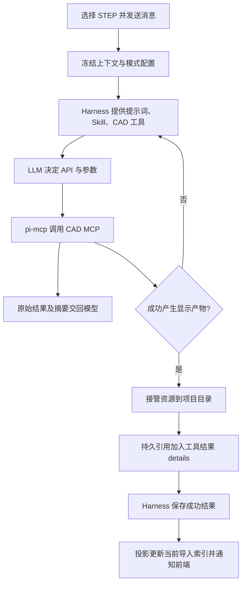

# 桌面后端设计

更新：2026-10-25。状态：通用 stdio 插件加载、原始 MCP 结果转发、显示产物接管及持久索引已接入；Runtime 已收拢为启动、请求队列和退出的组合入口，领域请求分布于现有模块。范围和工程约束见 [规范入口](../README.md)，交互见 [前端设计](../frontend_spec/frontend.md)，插件契约见 [CAD MCP 设计](../mcp_spec/cad-mcp.md)。

## 1. 职责与进程

Electron Main 管窗口、系统能力和受控资源协议；Preload 暴露有限类型化 API；独立 Node 后端管理应用数据、AI、Harness、MCP 连接及显示产物。builtin 读取插件随附启动描述，通过 pi-mcp 的标准 stdio 启动各插件服务；插件自己的 TS SDK 服务端调用 C++ 子进程负责几何计算。

一个应用数据目录只打开一个 SQLite 和一个 durable Harness，各对话保持原生身份与独立上下文。首阶段保持一个前台 Run，工具按顺序执行；不新增执行器、工作流状态机、任务队列或第二份聊天记录。

业务顺序由 LLM 根据 Skill 和真实工具结果决定。后端不自动串联导入/等待/显示，不注册 scene_import_selected_step 一类替代 CAD API 的业务工具。

## 2. 模块与依赖

当前目录如下；按实际职责组织文件，不预建空模块或继承层。

```text
src/backend/
  index.ts                 # IPC 入口，创建并关闭应用
  runtime.ts               # 组合存储、领域请求、统一队列及应用退出
  types.ts                 # 方法与输入/输出相关联的 Handlers 类型
  projects/handlers.ts      # 项目、STEP 关联、对话元数据及显示查询
  settings/handlers.ts      # 配置快照、Provider、登录与 Skill 请求
  settings/documents.ts     # SettingsRecord 与 durable 配置文档
  agent/session.ts         # 单一活动 Run、订阅、发送、停止及收尾
  agent/types.ts           # ActiveRun 与冻结的 RunContext
  agent/                   # 模式提示词、Skill、工具注册及事件投影
  mcp/handlers.ts           # MCP 配置与可取消的工具发现请求
  mcp/                     # builtin、连接、发现、调用、取消和资源读取
  artifacts/               # 显示产物接管、持久索引和资源查询
src/shared/
  application.ts           # 前后端请求/结果/事件的 Schema 与推导类型
  display.ts               # ImportedModelRef、ImportedModel 等显示契约
resources/mcp/cad/          # CAD 自己的协议与原生实现
resources/skills/scene-building/SKILL.md
```

| 模块 | 所有权与边界 |
| --- | --- |
| runtime | 打开唯一 Harness、先清理旧任务、组合领域处理器、维持请求顺序并关闭资源；不写认证、几何或产物算法 |
| projects | 真实目录身份、STEP 扫描/关联、对话元数据；聊天执行/历史交给 durable |
| settings | 复用 pi-ai Provider/AuthInteraction/CredentialStore；复用现有认证算法和安全存储 |
| agent | 唯一 Harness、模式提示词、本轮冻结上下文、工具注册及 watchEvents 投影 |
| mcp | pi-mcp 统一 stdio/http 连接、实际 tools/list、通用 durable ToolTask 适配；不解释 CAD 命令，不运行插件服务端 |
| artifacts | 接收显示契约、校验/接管文件、记录成功导入及提供前端资源 |
| CAD 插件 | 不导入 src/backend，不接收 SceneHost、数据库或 Harness 回调 |

运行目标类型集中于 agent/types.ts，持久结构与所属模块的 durable 文档一起定义；跨模块类型只在其所属模块导出，跨进程契约集中于 shared。领域处理器使用普通函数和明确依赖，不新增通用容器、路由框架或继承层。保留成熟的小函数，不重新实现 SDK 提供的能力。

## 3. 核心数据结构

| 类型 | 字段与语义 |
| --- | --- |
| StepSource | id、projectId、relativePath；同目录同路径复用身份，同内容不同路径不自动合并 |
| RunContext | conversationId、project、source、skill；source 含持久来源 id、绝对 path、相对路径及发送时 sha256；模式/模型及 MCP/Skill 配置快照沿用原生配置和 app.input，不在显示模块重复保存 |
| ActiveRun | conversationId、scene、context、skillBody、mcp；会话模块唯一持有的本轮运行记录，完成回调用对象身份核对归属，防止旧任务收尾释放新任务资源 |
| ImportedModelRef | importId、sourceId、sourceHash；持久模型引用，不含任意本地路径 |
| ImportedModel | 引用、projectId、importFingerprint、producerTaskId、producerEntryId、清单及资源的受控 URL/大小/hash、创建时间和警告；查询时附 sourceStatus:current/changed/missing |
| DisplayDetails | 通用工具身份、display?:ImportedModelRef、displayError?:{code,message}；写入 Harness 工具结果 details |
| ViewState | 前端临时相机、选择及加载状态；后端不保存为业务版本 |

CAD 自己的 document/job/object 及 DisplayArtifact 按 [插件契约](../mcp_spec/cad-mcp.md) 定义，后端不创建另一套 CAD 对象 ID 或查询 API。

importId 标识一次完整显示产物，与聊天身份、临时 CAD 句柄分开。源文件 hash 表示内容版本，importFingerprint 表示导入方式，具体网格资源由 importId 和清单确定。首阶段不设计可编辑 SceneDocument、场景 revision、previousId 链或场景历史恢复。

ImportedModel 指向插件生成的只读清单与资源；桌面不再维护一份含颜色覆盖、分组、连杆和关节的第二模型。运行任务、订阅和配置更新保持单一所有者，数据传给调用方时返回只读快照或副本。

## 4. 完整工作流



选中 STEP 的完整绝对路径在本轮上下文中提供给模型，cad_import_step 的 path 必须由模型显式返回。执行前验证它属于本轮所选项目和文件，不能缺省代选。插件自己负责解析、几何版本和句柄，不从全局当前 UI 状态取目标。

CAD 文档导入、显示资源生成及 job 等待是独立工具；模型可以选择先查询结构。返回 job 仅表示任务已接受，只有成功的显示结果触发资源接管。重复查询同一完成 job 必须复用同一显示产物，不生成重复导入记录。

## 5. 显示产物接管与 Harness

MCP 服务可在 CallToolResult 的 `_meta["dai/display"]` 提供 DisplayArtifact。它是应用约定，不是 MCP 自动识别的三维标准。通用工具适配只校验这一契约，不按 toolName、助手文字或原始 JSON 字符串猜测显示行为。

处理顺序：

1. MCP 返回结果，通用适配检查错误/取消、显示契约、来源 hash 和本轮目标。
2. artifacts 从服务返回的已登记资源引用获取清单与文件。同机受信任 stdio 使用 file URI 流式复制，校验其属于该连接的私有输出范围，并校验大小/hash、对象映射及依赖；接管到项目的应用产物目录。服务间不传内存读取回调。
3. 完整文件准备好后返回 ImportedModelRef，适配将其放入 ToolExecutionResult.details，模型仍得到真实工具输出及必要警告。
4. Harness 成功结果被记录后，结果投影记录 ImportedModel 和该来源最近成功的 importId，发布 display.changed。只有文件存在、校验通过且有成功工具结果的产物才能进入当前显示索引。

资源接管在工具返回给 Harness 前 await 完成，防止后续 release/退出先清空插件临时文件。来源属于冻结 RunContext，不能因用户界面切换被挂到另一个 STEP。接管失败保留 CAD 原始成功/失败状态，在 details.displayError 与模型可见警告中报告显示发布错误，保留原显示；不伪装已发布，也不将已完成的 CAD 计算描述为未执行。

重复工具结果、重复订阅及重连按服务实例＋产物资源身份复用 importId；ImportedModel 保存 producerTaskId/producerEntryId 供核对，不新增通用去重账本。事件通知失败不撤销成功结果。成功结果已记录而索引尚未更新时，重连/启动以原生成功记录核对并幂等补齐；不执行工具、不依据旧聊天文字覆盖新结果。该故障窗口必须有实际恢复测试。

结果订阅不能因用户当前只看普通聊天而丢失索引更新。前端只在显示来源匹配时加载；首次订阅读取该来源最新索引，不能依次播放历史中的每个模型引用。

当前实现：artifacts/prepare.ts 流式复制服务已登记且位于该连接私有目录内的资源，校验来源、大小/hash、对象树、独立 GLB 和完整 CAD 面映射；单份清单上限 32 MiB，整份显示资源上限 2 GiB。持久清单复用 CAD 格式，仅将资源 URI 替换为 dai-resource URL，保留原始层级和几何，不另建一份可编辑场景。metadata.json 记录接管信息；准备完成通过同目录原子 rename 发布文件。

artifacts/store.ts 通过 Harness 的公开 subscribeCommits 观察已提交条目，异步索引成功 toolResult.details.display；不依赖当前聊天的 UI 订阅。ImportedModel 和每来源的最近导入索引使用原生 Documents，来源指针按生产条目 ID 单调更新。启动从原生条目核对并恢复丢失索引；只有文件、没有成功条目的准备目录不发布，重复完成结果不生成新 importId 或重复通知。

普通外部 MCP 仍可调用并显示聊天工具结果；只有遵守显示契约且提供受支持资源读取方式的服务才参与三维显示。第一阶段验收内置 CAD，不建设任意二进制格式查看平台。

## 6. 存储及迁移

| 位置 | 内容 |
| --- | --- |
| 用户目录 .daidai/app.sqlite | durable 原生聊天/任务；设置、项目、STEP 关联、成功导入索引等 Documents |
| 用户目录 .daidai/credentials.enc | 系统安全存储保护的凭据；不可用时仅本次保留，不写明文 |
| 项目 .daidai/artifacts/<importId>/ | 不可变导入清单、资源及接管元数据 |
| 用户目录 .daidai/tmp/ | 插件拥有的临时计算输出，由生命周期管理 |

Linux/macOS 使用 `~/.daidai`，Windows 使用 `%USERPROFILE%\.daidai`；与启动目录无关。沿用显式测试数据目录隔离能力。

源 STEP 只读。聊天不拥有 CAD 产物，删除对话或移除项目不删除文件。前端相机/选择只在内存；原始 B-Rep 只在 CAD 进程中；重新显示已接管模型不依赖原始 STEP 或活的 CAD 文档。

保留现有账号、设置、项目及原生 Conversation 身份和历史，不通过重建数据库实现重构。旧 modeling/assembly 配置不再激活，未知的其他外部配置不能被误删。旧场景文件及记录保留，但不自动迁成新的可编辑模型；界面说明需显式重新导入，旧历史仅展示记录，不重放旧工具或伪称旧操作已迁移。

## 7. 模块入口与应用接口

| 模块入口 | 输入 → 输出 / 行为 |
| --- | --- |
| openRuntime | 路径、凭据存储、事件接收器 → request/resolveResource/close；唯一组合入口 |
| createSettings | 凭据存储与 Harness 访问函数 → Provider、配置读取/更新及设置请求；先创建模型组件，完成旧任务恢复后再初始化持久配置 |
| createProjects | Harness 与存储 → 项目/对话读取及领域请求；订阅停止、默认模型和显示查询通过明确方法传入 |
| createSession | Harness 及现有模块 → conversation.watch/send/stop、活动 Run 和订阅生命周期；发送复用原生 requestId 去重，停止等待原生 abort 和进程释放 |
| createMcpHandlers | 设置、项目读取及空闲检查 → MCP 请求、检查状态及取消；只持有当前发现操作 |
| loadBuiltins | 可信程序路径与配置 → CAD 服务定义、工具目录及 close；不接收场景编辑回调 |
| registerMcpTool | 真实工具声明、连接、RunContext → durable 工具；统一参数校验、进度、输出及显示接管 |
| prepareDisplayArtifact | 连接的资源范围、DisplayArtifact、RunContext → 已准备的持久模型引用 |
| acceptToolResult | 原生成功结果及其显示引用 → 幂等记录成功导入、更新来源指向并发通知 |
| getImportedModel | 已授权的对话/来源 → 最近成功 ImportedModel 或 null |

前后端保留项目/对话、设置、登录及工具配置的有限方法。新显示接口为 `display.get({id:conversationId})`，返回 ImportedModel 或 null；事件为 `display.changed({sourceId,importId})`，前端重新查询。资源读取沿用受控 dai-resource 协议，由 Main 根据已登记模型解析文件，不经 renderer 暴露原始路径。

Main 与后端之间使用私有 resource 消息解析 importId/resourceId，Preload 不暴露文件路径解析方法。Main 只提供 GET/HEAD 并流式返回已登记文件；项目移除、未知身份、越界和符号链接拒绝访问。生产页 CSP 的 connect-src 仅放行 dai-resource，开发页另保留 Vite 自身及热更新连接。

旧 scene.apply/history/restore/export 等接口随调用方一并移除。前端不再调用 scene.import 绕过模型；如保留“解析”快捷入口，它只发送一条明确用户请求给当前对话，由同一 Harness 路径执行。

## 8. Skill、停止与恢复

通用对话与场景搭建分别维护系统提示词。内置 scene-building Skill 首阶段只描述使用选中绝对路径导入 STEP、等待任务、按需要查询结构、生成显示并报告实际结果。它是 Markdown 说明，由 durable sections 注入，不承担几何计算或程序调度。

运行前冻结模型/账号、项目、STEP、MCP 与 Skill 配置。运行中拒绝换源或配置；用户先停止再切换。停止等待真实工具终止，不能只结束请求等待就声称计算已停止。已接管且记录成功的产物保留；取消/失败不发布未完成产物。

恢复只打开已有记录和成功导入，不续跑上次未完成任务。复用已核查的 durable inspect/abortTask/abortSubmission 等公开能力，先标记旧工作取消，再启用调度完成清理；不 fork SDK 或读取私有任务结构。订阅重连使用原生快照及批次，无第二套事件重放队列。

关闭窗口到托盘保留运行；真正退出统一停止、关闭 MCP/原生 worker、Harness 和存储。主进程 10 秒与原生 worker 5 秒的现有限时继续作为可验证边界，超时不能宣称未完成工作已保存。

Runtime 保留唯一请求 Promise 链，前一次失败不阻断后续请求；只有 `mcp.cancelInspect` 绕过队列，才能取消正在等待的发现请求。`conversation.stop` 仍在原队列内，不改变现有修改顺序。领域模块不各自建立队列。

运行收尾集中在会话模块：正常完成先等待 artifacts.flush，再并行关闭本轮外部 MCP 与场景 CAD；发送初始化失败并行释放外部 MCP 和 CAD；显式停止先等待 conversation.abort，再依次关闭外部 MCP、释放 CAD，释放失败保留运行记录供重试。核对 ActiveRun 归属后清空运行状态，旧回调不能释放新 Run 的 worker。显示索引及文件接管仍由原 artifacts 模块负责。

真正退出先标记 closing 并立即中止 MCP 发现，取消登录并排空已接收请求，再停止订阅、取消原生 submission/task、等待 Harness 空闲。外部和内置 MCP 以 allSettled 清理，随后关闭 artifacts、Harness；重复 close 共用同一 Promise，释放失败仍报告错误。启动恢复依旧在任何可能启动调度器的 API 之前处理旧工作。

## 9. 后端验收

后端单元测试集中在 `tests/backend/`，共享协议测试在 `tests/shared/`；跨模块流程在 `tests/integration/`，通用 MCP 连接测试在 `tests/mcp/`。测试目录规则见 [规范入口](../README.md)。

- 普通聊天、登录、模型配置、项目/对话身份、归档/删除及数据目录保持可用；不消耗个人付费账号做自动测试。
- 使用脚本模型对端，真实 Harness → pi-mcp → 官方 SDK → C++，证明每项业务工具由模型选择。
- CAD 插件不依赖后端实现或 SceneHost；通用连接、结果接管与 Agent 不包含几何操作顺序。
- 正确路径导入；空参数、错文件、过期来源、未知资源或 hash 错误明确失败并保留原显示。
- 覆盖大资源流式接管、重复完成结果、准备后崩溃、成功记录后索引失败、重连恢复及来源切换。
- 覆盖计算中取消、接受结果未知、取消后的真实退出、托盘保持及真正退出；不遗留活动进程，不误重放工具。
- 验证请求排队与 MCP 发现取消例外、退出时排空请求及重复 close；模拟停止释放失败与旧 Run 延迟收尾，确认可重试且不会释放新 Run 的资源。

部分显示沿用同一资源接管和 Harness 提交流程，不新增执行器或 adapter。complete=false 不再是拒绝显示的条件；后端必须验证原面数、排除数、排除面清单与实际 GLB/三角形范围一致。全部无法显示、旧的不完整未过滤产物、损坏或不匹配资源仍拒绝并保留旧显示。
